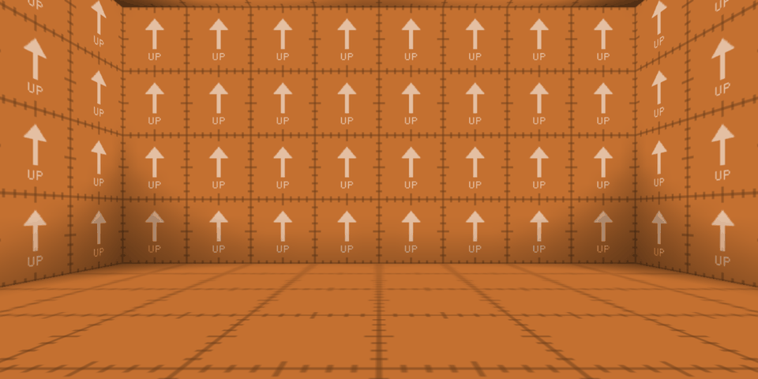
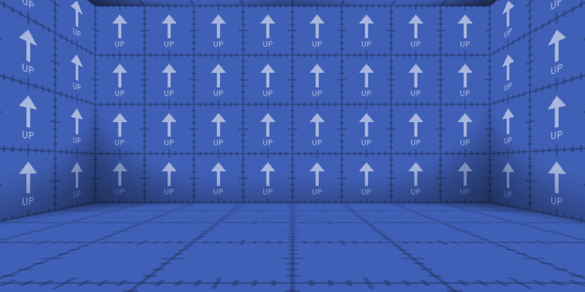

# Chapter 1: quortal on ioquake3





quortal's first step builds no portal. It builds the game the portals go into: ioquake3, made into a standalone game called quortal, which you build from its source with free tools and run on free data, so that you can follow every later step without owning Quake III Arena.

Its [station](glossary.md#station) is the two rooms of `test_first`, the first test map, one orange and one blue, textured and lit alike. Above, you see each from the same spot in it, facing the thick wall that chapter 2 puts a [portal end](glossary.md#portal-end) in. The blue room is the orange room turned half round and moved 1024 units along, so apart from their colour, the two pictures are the same. That's what a portal between the rooms needs: standing in one, you'll see the other through the wall, and only the colour will show you where the opening is.

Standing there, you're running quortal's own game code, not OpenArena's, on ioquake3's OpenGL 1 renderer, GL1, in a window with 8 stencil bits. None of it shows in the pictures, but every later step relies on it, and this chapter is about how quortal makes sure of it.

## What you need to know of ioquake3

ioquake3 carries on the Quake III Arena engine, whose source id Software released under the GPL in 2005. A handful of its parts matter here. Fabien Sanglard's [Quake 3 source code review](https://fabiensanglard.net/quake3/) tours the rest.

**The engine and the game code.** The engine runs the game's loop, its files, network, sound and drawing. The [game code](glossary.md#game-code) is the game itself, in three modules: qagame, in [code/game](../code/game), the game as the server runs it; cgame, in [code/cgame](../code/cgame), the client's side of it, which predicts your movement and decides what to draw; and ui, in [code/q3_ui](../code/q3_ui), the menus. Each module is built two ways: as a [QVM](glossary.md#qvm), bytecode that the engine compiles to machine code as it loads it, or interprets on a machine it has no compiler for, and that can reach nothing outside its own memory but through the engine's calls; and as a native library. The cvars [`vm_game`](../code/qcommon/vm.c), [`vm_cgame`](../code/qcommon/vm.c) and [`vm_ui`](../code/qcommon/vm.c) choose which, and QVMs are the default.

**Game folders and pk3s.** Everything the game reads, its maps, textures, shaders, sounds and QVMs among them, comes from a game folder, `baseq3` for Quake III Arena. A game folder holds [pk3s](glossary.md#pk3), which are zip files, and loose files. The game folder in your home folder is searched first, then the one beside the binaries. In each, loose files come before pk3s, and pk3s come in reverse order of their names, so a patch named `pak6.pk3` overrides what's in `pak0.pk3`.

**Pure servers.** [`sv_pure`](../code/server/sv_init.c) is 1 by default, which makes a [pure server](glossary.md#pure-server): it gives its clients the list of the pk3s it has loaded, and they load only from those, so that everyone plays the same data and the same game code. It holds in single player too, where the server and the client run in one process, and share one filesystem.

**Standalone games.** ioquake3 can be built for a game of its own, with [`STANDALONE`](../code/qcommon/q_shared.h) defined, which leaves out everything that looks for Quake III Arena: its `pak0.pk3`, its CD key, and id's server that checked the key. The new game's names come from `q_shared.h`, where they're placeholders until a game sets them.

**Renderers.** ioquake3 has two, each a library the client loads as it starts. GL1, in [code/renderergl1](../code/renderergl1), draws with OpenGL 1's fixed functions, as Quake III Arena did. GL2, in [code/renderergl2](../code/renderergl2), draws with shaders, and adds HDR, shadows from the sun and more. [`cl_renderer`](../code/client/cl_main.c) chooses between them.

**The stencil buffer.** Beside each pixel's colour and depth, an OpenGL window can keep a [stencil](glossary.md#stencil-buffer) value: a few bits that drawing can set and test, so that later drawing lands only where earlier drawing marked. ioquake3 asks for 8 bits, as [`r_stencilbits`](../code/renderergl1/tr_init.c), and uses them only for stencil shadows, which [`cg_shadows`](../code/cgame/cg_main.c) 2 turns on, and for [`r_measureOverdraw`](../code/renderergl1/tr_cmds.c), a debug cvar that counts how often each pixel is drawn. Portal views keep each view to its opening with them, as chapter 4 shows.

**Maps.** A map's source is a `.map` file of brushes, which are convex solids, and entities, made in an editor. q3map2 compiles it in three stages. `-bsp` cuts the world into a tree of convex leaves, a binary space partition, `-vis` works out which leaves can see which, and `-light` bakes the light into lightmaps. The result is a `.bsp` file in a pk3's `maps` folder.

## What stands in the way

Built as it comes, ioquake3 at 87a99d1 is no use for following along.

- **It's Quake III Arena's engine.** Unless it's told at run time that it's running another game, [`FS_CheckPak0`](../code/qcommon/files.c) stops it as it starts when Quake III Arena's paks aren't there, and those you'd have to buy.
- **Its free data brings its own game code.** OpenArena's data is free, and fits ioquake3's game code. But three of OpenArena's paks, `pak0.pk3`, `pak6-patch085.pk3` and `pak6-patch088.pk3`, each hold OpenArena's own `vm/qagame.qvm`, `vm/cgame.qvm` and `vm/ui.qvm`. Under a pure server, the default, the game code is loaded from the pak that sorts last among those that hold it. You'd be playing OpenArena's game code, which knows nothing of portals, and plays so like quortal's that you might never notice.
- **Its default renderer has no stencil.** GL2 has been ioquake3's default since 2016, and under its default HDR, it draws into a framebuffer of its own, which has no stencil. GL1 draws into the window, which has one, but the menus could still set `r_stencilbits` to 0, and stencil shadows count through every bit of it.
- **It has no map compiler.** Every step is seen at a station in a test map, and nothing would build the maps.
- **Nothing would tell you if any of this broke.** ioquake3 has no tests.

## The choices

### A fork, not a mod

Most games made on Quake III Arena are mods: they change only the game code, and keep the engine as it is. Portals can't be a mod. The renderer has to draw a view through each portal end and keep it to the opening, and the server has to send what lies beyond the wall. Both are the engine's, out of the game code's reach.

So quortal is a fork. It's ioquake3 with its whole history, up to 87a99d1, and quortal's commits on top, each small and explaining itself, so that you can tell quortal's changes from ioquake3's, and read them in order. Valve could change Source wherever Portal needed it to, since the engine was Valve's own. Prey, which put portals you can walk through into a heavily modified id Tech 4 in 2006, shows why that matters to a learner: only its game code was ever published, never the engine code that draws its portals.

### Standalone at build time

ioquake3 offers two ways to be a game of your own. At run time, [`com_basegame`](../code/qcommon/common.c) set to a folder of its own, with no Quake III Arena paks around, turns its checks off, and keeps the stock binaries. At build time, `STANDALONE` compiles them out. quortal changes the engine anyway, so it gains nothing from the stock binaries, and the run-time way leaves the stock menus asking for a CD key. quortal builds standalone.

### OpenArena's data

Quake III Arena's data isn't free, and neither is that of the free-to-play games made on ioquake3: World of Padman's may be used for World of Padman only, and Q3Rally's has no known licence. Tremulous's and Turtle Arena's are free in part, but they're other games, with game code of their own. Data made only for quortal would be small and wholly its own, but bare: chequerboard menus, and a player model of its own, which portal views will show you, since you'll see your own body through them.

OpenArena 0.8.8 is a whole set of data made to replace Quake III Arena's, under the GPL, version 2 or later, and ioquake3's own game code plays on it unchanged. Its gaps are small: one map's music, the second models of three items, the single-player postgame and one sound, which quortal's test maps stay away from. It's a 425 MB zip from 2012, which quortal fetches rather than keeps a copy of, since a copy would stay in the history for good. Linux distributions package it too, but only for Linux, and split differently.

### quortal's own pk3

Something has to make sure quortal's game code, and not OpenArena's, is what runs. quortal could run its native libraries by default, with `sv_pure 0` and `vm_* 0`. That changes two of ioquake3's defaults, and turning pure back on would bring back OpenArena's code without a word. A `.pk3dir`, a folder read as if it were a pk3, is ignored by a pure server.

quortal zips its game code into a pk3 of its own, `quortal.pk3`, beside OpenArena's paks, whose name sorts after every one of theirs. OpenArena shipped its own fixes the same way, as `pak6-patch085.pk3` and `pak6-patch088.pk3`, which sort after the paks they patch. Being a pk3, `quortal.pk3` is on the list a pure server gives its clients, and sorting last, it holds the first game code found, whether the server is pure or not.

### GL1, and its stencil bits

quortal could make portals in GL2, in GL1, or in both. Both would mean making every change twice, and explaining both. GL2's own framebuffer has no stencil under its default HDR, and its depth pre-pass, shadow mask and ambient occlusion would all run again for every portal view. GL1 is smaller and fixed-function, so quortal's changes stand out in it. It draws straight into the window, which has the stencil. It already clips the view it draws for ioquake3's portal surfaces and mirrors with a clip plane. And it runs on macOS's old OpenGL 2.1. quortal makes GL1 its only renderer.

Its 8 stencil bits go to portal views. Portal drew its portal views through the stencil buffer too, having moved to it from the textures of Narbacular Drop, the student game Portal grew from, and Valve's Dave Kircher has recalled that its 8 bits had to be conserved. Doom 3 draws its mirrors with no stencil, inside a scissor rectangle around each, and its remote cameras into a texture. Chapter 4 says why quortal draws like Portal. Here, it's enough that portal views will need all 8 bits, so stencil shadows, which count through every one, give way to blob shadows, and no menu setting takes the bits away.

### Checks that compare quortal with itself

ioquake3 has no tests. Its own way of showing what it does is its console: debug cvars such as [`cg_showmiss`](../code/cgame/cg_main.c), and [`timedemo`](../code/qcommon/common.c). quortal's checks follow it. Each runs the game, or the dedicated server, from the command line, and reads its console log for lines that state a rule, such as the server's `gamename: quortal`. A check never compares with a stored image or a recorded number, so it passes on any GPU, and survives a change to a map that keeps its case.

Every step brings its own checks, and CI runs them on Linux at every push, and on Windows before each step is finished. Neither machine has a GPU, so they render in software, with Mesa's llvmpipe, which still gives the window 8 stencil bits.

### A fetched map compiler

The test maps are committed as their `.map` sources, and compiled as quortal builds. A compiled `.bsp` is never committed: it's a large binary that would stay in the history at every change, and could drift from its source. q3map2 compiles them, the free compiler that comes with the Radiant editors, from NetRadiant-custom, the most active of those, which releases builds for Linux and Windows, and whose q3map2 also reads the format TrenchBroom writes maps in. quortal fetches it as it fetches OpenArena's data, pinned to one release and checked, so that a map compiles the same for you as in CI, and a new q3map2 only ever comes with a commit.

### Docs that stay true, and are free to reuse

Each step is one feature branch, merged into develop as one merge commit, and its chapter is the branch's last commit, written once the step's code is final. So `git log --first-parent develop` lists the steps, and checking out a step's merge shows its code as the step left it. The chapters are living: a later step that changes code a chapter explains rewrites the chapter too, and a docs check keeps every link, identifier, excerpt and list of commits true. Chapters frozen as they were written would leave you, reading at the tip, reading about code that has since moved on, and the frozen view is there anyway, at each step's merge. They're plain Markdown, which you read on GitHub or in a clone, with no site to build.

quortal's own prose and figures are under CC BY 4.0, so that you can lift them into a course, a book or a slide, as long as you credit quortal. Everything else stays under the GPL: the code, including what the docs quote, which can't be relicensed, and the screenshots, which show the game's data. CC BY-SA was the other candidate, but it's compatible with the GPL one way only, with version 3, so text from the docs could never become a comment in quortal's GPL-2.0 code. CC BY is compatible with every version.

## The code

### A standalone game called quortal

[`BUILD_STANDALONE`](../CMakeLists.txt) is on by default now. It defines `STANDALONE` for the client and the server, which leaves [`FS_CheckPak0`](../code/qcommon/files.c) out of the filesystem's start, in [files.c](../code/qcommon/files.c):

```c
#ifndef STANDALONE
	FS_CheckPak0( );
#endif
```

In some thirty other places, it leaves out the CD key and its check with id's server too. The game's names are set where `STANDALONE` defines them, in [q_shared.h](../code/qcommon/q_shared.h):

```c
#ifdef STANDALONE
  #define PRODUCT_NAME				"quortal"
  #define BASEGAME					"quortal"
  #define CLIENT_WINDOW_TITLE		"quortal"
  #define CLIENT_WINDOW_MIN_TITLE	"quortal"
  #define HOMEPATH_NAME_UNIX_LEGACY	".quortal"
  #define HOMEPATH_NAME				"quortal"
  #define GAMENAME_FOR_MASTER		"quortal"	// must NOT contain whitespace
//  #define CINEMATICS_LOGO		"foologo.roq"
//  #define CINEMATICS_INTRO		"intro.roq"
//  #define LEGACY_PROTOCOL	// You probably don't need this for your standalone game
//  #define PROTOCOL_HANDLER		"foobar"
  #define CONFIG_PREFIX			"quortal"
```

Lowercase `quortal` names everything: the product, the base game and so its folder, the window, the folder in your home folder, the game as master servers list it, and the config file, `quortal.cfg`. The two cinematics are commented out, since OpenArena ships neither. CMake keeps its own copy of the names, in [identity.cmake](../cmake/identity.cmake), which names the binaries `quortal` and `quortal-ded`, and the game folder `quortal`. The two copies are kept the same by hand.

ioquake3 builds the game code without the engine's definitions, so without more, qagame, cgame and ui would keep ioquake3's names, and the [`gamename`](../code/game/g_main.c) qagame prints as it starts would be `baseq3`. They get `STANDALONE` too, through [`GAME_MODULE_DEFINITIONS`](../cmake/basegame.cmake), in [basegame.cmake](../cmake/basegame.cmake):

```cmake
# The game modules don't share the engine's definitions, but they need
# STANDALONE too, for q_shared.h to give them the same identity
if(BUILD_STANDALONE)
    list(APPEND GAME_MODULE_DEFINITIONS STANDALONE)
endif()
```

The renderer gets it as well, in [renderer_common.cmake](../cmake/renderer_common.cmake), since it opens the window, which takes its title from `q_shared.h`.

On Linux, a client named `quortal` would have the same path as the `quortal` game folder beside it, so [`add_arch_suffix`](../cmake/platforms/linux.cmake) names both binaries for their architecture, `quortal.x86_64` and `quortal-ded.x86_64` on a PC, in [linux.cmake](../cmake/platforms/linux.cmake):

```cmake
# Without an extension, the client would have the same path as the base
# game's folder beside it, so both binaries are named for their architecture
if(NOT EMSCRIPTEN)
    list(APPEND POST_CONFIGURE_FUNCTIONS add_arch_suffix)
endif()

function(add_arch_suffix)
    foreach(BINARY IN ITEMS ${CLIENT_BINARY} ${SERVER_BINARY})
        set_target_properties(${BINARY} PROPERTIES SUFFIX .${ARCH})
    endforeach()
endfunction()
```

### GL1, with 8 stencil bits

[`BUILD_RENDERER_GL2`](../CMakeLists.txt) is off by default now, so GL2 isn't built, though its source is untouched, which keeps merges from ioquake3 simple. The client loads GL1 by default, in [`CL_InitRef`](../code/client/cl_main.c), in [cl_main.c](../code/client/cl_main.c):

```c
#ifdef USE_RENDERER_DLOPEN
	cl_renderer = Cvar_Get("cl_renderer", "opengl1", CVAR_ARCHIVE | CVAR_LATCH);

	Com_sprintf(dllName, sizeof(dllName), "renderer_%s" DLL_EXT, cl_renderer->string);
```

[`r_stencilbits`](../code/renderergl1/tr_init.c) asks for 8 bits by default. In ioquake3, both menus set it to 0 for 16-bit colour, and Team Arena's menu does for its Fastest preset too. In quortal they set 8, in [`GraphicsOptions_ApplyChanges`](../code/q3_ui/ui_video.c) and in Team Arena's [`UI_Update`](../code/ui/ui_main.c).

Stencil shadows give way at the start of each frame, in [`RE_BeginFrame`](../code/renderergl1/tr_cmds.c), in [tr_cmds.c](../code/renderergl1/tr_cmds.c):

```c
	//
	// portal views own the stencil buffer, so stencil shadows
	// fall back to blob shadows
	//
	if ( r_shadows->integer == 2 )
	{
		ri.Printf( PRINT_ALL, "Warning: portal views own the stencil buffer, using blob shadows instead\n" );
		ri.Cvar_Set( "cg_shadows", "1" );
	}
```

The renderer reads cgame's `cg_shadows` as its own [`r_shadows`](../code/renderergl1/tr_init.c), so setting it back to 1 is all it takes, and the warning shows once.

Last, [`GfxInfo_f`](../code/renderergl1/tr_init.c), which prints what OpenGL gave the window as the renderer starts, and again on the `gfxinfo` command, says when that's fewer than 8 stencil bits, in [tr_init.c](../code/renderergl1/tr_init.c):

```c
	ri.Printf( PRINT_ALL, "\nPIXELFORMAT: color(%d-bits) Z(%d-bit) stencil(%d-bits)\n", glConfig.colorBits, glConfig.depthBits, glConfig.stencilBits );
	if ( glConfig.stencilBits < 8 )
	{
		ri.Printf( PRINT_WARNING, "WARNING: portal views need 8 stencil bits, the display gave %d\n", glConfig.stencilBits );
	}
```

quortal runs without them all the same. From chapter 4 on, though, it draws no portal view without them, only each portal end's own surface.

### OpenArena's data

The [`openarena`](../cmake/openarena.cmake) target runs [fetch_openarena.cmake](../cmake/utils/fetch_openarena.cmake), a script for `cmake -P`, which needs nothing CMake doesn't have. It pins what it fetches, in [fetch_openarena.cmake](../cmake/utils/fetch_openarena.cmake):

```cmake
set(ZIP_NAME openarena-0.8.8.zip)
set(ZIP_SIZE 425189255)
set(ZIP_SHA256 5a8faf7f5b51f351b0a1618c06b6b98a5f1a6758f1d39818de2c87df2a0bac4a)

set(URLS
    https://downloads.sourceforge.net/project/oarena/${ZIP_NAME}
    https://download.tuxfamily.org/openarena/rel/088/${ZIP_NAME})
```

[`fetch_to_cache`](../cmake/utils/fetch_to_cache.cmake) tries each URL in turn, and keeps the first download of the right size and SHA-256 in your cache folder, which [`get_cache_dir`](../cmake/utils/fetch_to_cache.cmake) finds on each platform. A file there that doesn't match is thrown away and fetched again, and one that does is never fetched again, so a second build tree downloads nothing. The script then extracts OpenArena's nine `baseoa` paks into the game folder beside the binaries, `build/Release/quortal`. It never puts them in the game folder in your home folder, which is searched first: OpenArena's paks there would win over `quortal.pk3`.

The target isn't part of the default build, since it's a 425 MB download, and `cmake --install build --component openarena` does the same for an install.

### quortal.pk3

[`FS_AddGameDirectory`](../code/qcommon/files.c) adds a game folder's pk3s to the list of places a file is looked for. It sorts them by name, with [`paksort`](../code/qcommon/files.c), in [files.c](../code/qcommon/files.c):

```c
	if ( pakfiles ) {
		qsort( pakfiles, numfiles, sizeof(char*), paksort );
	}
```

then pushes each in turn onto the front of the list, so the pk3 that sorts last ends up first, in [files.c](../code/qcommon/files.c):

```c
			search = Z_Malloc(sizeof(searchpath_t));
			search->pack = pak;
			search->next = fs_searchpaths;
			fs_searchpaths = search;
```

[`FS_PathCmp`](../code/qcommon/files.c) compares names without regard to case, and `quortal.pk3` sorts after all nine of OpenArena's paks, whose names start with `pak`, so its files are found before theirs. A module's QVM is found the same way: [`FS_FindVM`](../code/qcommon/files.c) walks the same list, and once the server has named its pk3s, it skips every folder, in [files.c](../code/qcommon/files.c):

```c
		if(search->dir && !fs_numServerPaks)
```

So under a pure server the game code always comes from a pk3, and the first pk3 holding it is `quortal.pk3`. Any later pk3 of quortal's is named to sort after `pak6-patch088.pk3` too.

The game code is built as QVMs with ioquake3's own compiler, `q3lcc`, through [`add_qvm`](../cmake/utils/qvm_tools.cmake), which takes the pk3 a QVM goes in, in [basegame.cmake](../cmake/basegame.cmake):

```cmake
    # The QVMs go into quortal.pk3 only, never loose into the game folder, so
    # each one is loaded from the same file whether the server is pure or not
    add_qvm(${CGAME_MODULE_QVM_BASEGAME}
        DEFINITIONS CGAME ${GAME_MODULE_DEFINITIONS}
        OUTPUT_NAME ${CGAME_MODULE}
        OUTPUT_DIRECTORY vm
        PK3 ${BASEGAME}
        SOURCES ${CGAME_SOURCES_BASEGAME} ${CGAME_QVM_SOURCES})
```

A QVM for a pk3 is built into the pk3's own build folder, at its path in the pk3, rather than into the game folder, in [qvm_tools.cmake](../cmake/utils/qvm_tools.cmake):

```cmake
    # A QVM for a pk3 is built into that pk3's build folder, OUTPUT_DIRECTORY
    # being its path in the pk3, and only installed inside the pk3
    if(ARG_PK3)
        get_pk3_build_dir(${ARG_PK3} QVM_OUTPUT_DIR)
    else()
        set(QVM_OUTPUT_DIR ${CMAKE_BINARY_DIR}/$<CONFIG>)
    endif()
```

That matters, because while the server isn't pure, a game folder's loose files are searched before its pk3s, and a loose `vm/qagame.qvm` beside the binaries would be loaded in place of the one in `quortal.pk3`. With none there, each module comes from the same file either way.

[`add_pk3`](../cmake/utils/add_pk3.cmake) zips `quortal.pk3` from the files built for it, the QVMs and the compiled test maps, and from every file in [data](../data) but the `.map` sources: quortal's textures, and [CREDITS.txt](../data/CREDITS.txt), which credits OpenArena. [make_pk3.cmake](../cmake/utils/make_pk3.cmake) gathers them afresh in a staging folder each time, then zips that with CMake alone, as `quortal.pk3.part` beside the old pk3, and only once it's whole moves it over the old one, so that a game running from the build tree never opens a pk3 half written, in [make_pk3.cmake](../cmake/utils/make_pk3.cmake):

```cmake
# Zip it beside the pk3 and then move it over the pk3, so that a game
# running from the build never reads one half written
execute_process(
    COMMAND ${CMAKE_COMMAND} -E tar cf ${PK3_FILE}.part --format=zip -- ${PATHS}
    WORKING_DIRECTORY ${STAGING_DIR}
    COMMAND_ERROR_IS_FATAL ANY)

file(RENAME ${PK3_FILE}.part ${PK3_FILE})
```

The native libraries are still built, beside `quortal.pk3`, for [stepping through the game code](how-to/stepping-through-the-game-code.md) in a debugger.

To show which module came from where, [`VM_Init`](../code/qcommon/vm.c) registers a cheat-protected cvar, [`vm_showLoad`](../code/qcommon/vm.c), in [vm.c](../code/qcommon/vm.c):

```c
	vm_showLoad = Cvar_Get( "vm_showLoad", "0", CVAR_CHEAT );
	Cvar_SetDescription( vm_showLoad, "Show which file each game module is loaded from, and which pk3 holds it" );
```

[`VM_LoadQVM`](../code/qcommon/vm.c), which loads a QVM both as a module starts and at each `map_restart`, then prints its file and the pk3 it's in, in [vm.c](../code/qcommon/vm.c):

```c
	if(vm_showLoad->integer)
		Com_Printf("%s loaded from \"%s\" in \"%s\"\n", vm->name, filename, FS_SearchPathName(vm->searchPath));
```

and [`VM_Create`](../code/qcommon/vm.c) prints a native library's path. [`FS_SearchPathName`](../code/qcommon/files.c), which is new, names the pk3 or folder a place in the list reads from.

### The test maps

[`Q3MAP2`](../cmake/q3map2.cmake) is the q3map2 that compiles the test maps, in [q3map2.cmake](../cmake/q3map2.cmake):

```cmake
find_program(Q3MAP2 q3map2
    PATHS ${Q3MAP2_DIR}/bin
    DOC "NetRadiant-custom's q3map2, which compiles the test maps")
```

A `Q3MAP2` given when configuring comes first, then one on your `PATH`, then the one in `build/q3map2/bin`. The [`q3map2`](../cmake/q3map2.cmake) target puts one there, from NetRadiant-custom's release, which [fetch_q3map2.cmake](../cmake/utils/fetch_q3map2.cmake) fetches and checks with the same `fetch_to_cache`. On Linux, q3map2 is in an AppImage inside the release's `.7z`, and the script runs it with `--appimage-extract` to take it out. Until q3map2 is found, configuring warns, and `quortal.pk3` is built without maps. Fetching q3map2 makes the next build configure again, and find it.

[maps.cmake](../cmake/maps.cmake) compiles each `.map` in [data/maps](../data/maps) with [compile_map.cmake](../cmake/utils/compile_map.cmake), through q3map2's three stages, in [compile_map.cmake](../cmake/utils/compile_map.cmake):

```cmake
# custinfoparms.txt gives quortal's own surface parameters their bits
run_stage(-bsp -meta -leaktest -custinfoparms)

# A map that leaks would have no vis. With -leaktest, q3map2 then stops
# before writing the .bsp, but without failing
if(NOT EXISTS ${WORK_DIR}/${NAME}.bsp)
    message(FATAL_ERROR "${NAME} leaks: the way out of it is in ${WORK_DIR}/${NAME}.lin, "
        "which an editor can show as a pointfile")
endif()

run_stage(-vis)
run_stage(-light -fast -samples 2 -custinfoparms)
```

`-custinfoparms` reads `custinfoparms.txt`, where chapter 2 gives the plug a surface parameter of its own. Until then there's no such file, and q3map2 does without. No bot navigation file, `.aas`, is made, since the test maps have no bots. q3map2 reads quortal's [data](../data) folder and OpenArena's paks, for OpenArena's `common` shaders such as `common/caulk`, so the maps can't be compiled until the `openarena` target has fetched them.

[dev-textures.py](../misc/dev-textures.py) draws quortal's dev textures, in [data/textures/quortal](../data/textures/quortal). Each is a 64-unit grid with a tick every 8 units, in one of eight colours, so that each room can have its own. On the walls, an arrow and the label UP point to the top, so that a picture always shows which way is up, even through a portal end turned on its side.

[test_first.map](../data/maps/test_first.map) is two rooms, each 512 by 512 units and 256 high. The blue room is the orange room turned half round and moved 1024 units along x, with its four lights moved with it, so that the two are lit alike. Each has one wall 128 units thick, for a portal end: the orange room's north wall, and the blue room's south wall.

### The docs

The README at the top of the source is quortal's own now, and ioquake3's moves to [ioquake3-readme.md](ioquake3-readme.md). The [docs index](README.md) starts you at `test_first` and lists the chapters, the [glossary](glossary.md) says what the words they use mean, and two how-tos, [Building and running](how-to/building-and-running.md) and [Stepping through the game code](how-to/stepping-through-the-game-code.md), go into what the chapters only touch on. [CC-BY-4.0.txt](../CC-BY-4.0.txt), the legal code of CC BY 4.0, sits beside [COPYING.txt](../COPYING.txt), the GPL's, and its name has neither "licence" nor "copying" in it, so that GitHub still shows quortal's licence as the GPL. ioquake3's `.gitignore` ignored every path with a part starting `build`, the how-to on building among them, so now it ignores only the build trees at the top of the source.

### The checks

Every check is a CTest test, labelled in [tests.cmake](../cmake/tests.cmake) by what it needs: `docs`, `server` or `render`. Two run the game, through [`add_game_test`](../cmake/utils/add_game_test.cmake) and [run_game.cmake](../cmake/utils/run_game.cmake). Each run gets:

- a fresh home folder, so that no config of yours is read;
- `logfile 2`, so that the console log is written as it's printed;
- a timeout;
- on Linux, stand-ins for `zenity`, `kdialog` and `xmessage` that exit at once, since an error would otherwise wait in a dialog for a click nobody can make.

A check passes when the game exits cleanly with each line it expects in its console log. The server's, in [tests.cmake](../cmake/tests.cmake):

```cmake
if(BUILD_SERVER)
    # Its log names the game code that was loaded: OpenArena's says baseoa
    add_game_test(server_runs_quortal_game_code
        GAME ${SERVER_BINARY}
        LABEL server
        TIMEOUT 60
        ARGS +map test_first +quit
        EXPECT "gamename: ${BASEGAME}")
    list(APPEND MAP_TESTS server_runs_quortal_game_code)
```

qagame prints its `gamename` as it starts, and OpenArena's says `baseoa`. The client's check, [`client_opens_gl1_with_8_stencil_bits`](../cmake/tests.cmake), starts the client on `test_first` with [`activeAction`](../code/client/cl_main.c) set to `quit`, which runs once it has drawn its first frame in the game, and expects `renderer_opengl1` and `stencil(8-bits)` in its log.

The third check, [`docs_hold_true`](../cmake/tests.cmake), runs [check_docs.cmake](../cmake/utils/check_docs.cmake), which keeps this chapter true. Every relative link must lead somewhere. Every identifier linked as code, like [`VM_Create`](../code/qcommon/vm.c), must be in the file it links to. Every excerpt must be whole lines of the file linked just above it. And every commit under "How it was built" must be in the history. [list_commits.cmake](../cmake/utils/list_commits.cmake) prints that list.

CircleCI runs the checks, as [config.yml](../.circleci/config.yml) says, in four jobs. `docs` runs the docs check. `linux` and `windows` build quortal, fetch OpenArena's data and q3map2, build the test maps and run every check, rendering with llvmpipe: on Linux from Ubuntu's Mesa, under `xvfb-run`, and on Windows from mesa-dist-win, whose DLLs the checks put beside the client. `macos` only builds, since there's no q3map2 to fetch there. A push runs `docs` and `linux` at once, while `windows` and `macos`, which cost far more, wait to be approved, and run every time on develop and on tags. ioquake3's own GitHub Actions workflow is gone, so its builds, and its publishing of releases, never run for quortal.

## Try it

`test_first`'s two rooms are the only station so far. Start in the orange room:

```sh
build/Release/quortal.x86_64 +devmap test_first
```

`devmap` allows cheats, which quortal's debug features need. Open the console, with the key below Esc, and go to the blue room:

```
setviewpos 1024 240 24 -90
```

`setviewpos` pushes you forward as it puts you there, so you slide a little way. Chapter 4 adds `station`, which puts you at a named station at rest.

**Where each module comes from.** The step's debug cvar is `vm_showLoad`. It's cheat-protected, so set it as the game starts:

```sh
build/Release/quortal.x86_64 +set vm_showLoad 1 +devmap test_first
```

As each module loads, the console says where from:

```
ui loaded from "vm/ui.qvm" in "build/Release/quortal/quortal.pk3"
qagame loaded from "vm/qagame.qvm" in "build/Release/quortal/quortal.pk3"
cgame loaded from "vm/cgame.qvm" in "build/Release/quortal/quortal.pk3"
```

**A pure server wins over `vm_*`.** Add `+set vm_game 0 +set vm_cgame 0 +set vm_ui 0` to ask for the native libraries. ui and qagame load from their native libraries at first. Once the client has joined its pure server, ui and cgame load from `quortal.pk3`, and qagame does too after `map_restart 0`. With `+set sv_pure 0` as well, all three stay native. The cvars are saved in your config, so set them back to 2 afterwards.

**OpenArena's game code.** Move `quortal.pk3` out of `build/Release/quortal` for a moment, and start the dedicated server on one of OpenArena's maps, since `test_first` is in `quortal.pk3`:

```sh
build/Release/quortal-ded.x86_64 +set vm_showLoad 1 +map oa_dm1
```

```
qagame loaded from "vm/qagame.qvm" in "build/Release/quortal/pak6-patch088.pk3"
gamename: baseoa
```

That's what you'd be playing without `quortal.pk3`. Put it back.

**The stencil.** `gfxinfo` prints what OpenGL gave the window, and `PIXELFORMAT: color(24-bits) Z(24-bit) stencil(8-bits)` is the line that matters. Start with `+set r_stencilbits 0`, and the console warns that `portal views need 8 stencil bits, the display gave 0`. Set `cg_shadows 2`, and it says it's using blob shadows instead, and `cg_shadows` reads 1 again.

**The checks.** `ctest --test-dir build` runs all three, and `ctest --test-dir build -L render` runs only the client's.

## Limits

- **There's no portal yet.** `test_first`'s thick walls are plain walls. Chapter 2 puts a portal's ends in them.
- **Portals are GL1's alone.** GL2's source stays, but it isn't built, and nothing of quortal's reaches it.
- **Stencil shadows are gone for good.** `cg_shadows 2` gives blob shadows.
- **OpenArena's gaps stay.** `oa_dm1`'s music, the second models of the armour shard, the medkit and invisibility, the single-player postgame's music, sounds and podium, and `windfly.wav` are missing, and quortal's test maps avoid them all.
- **The test maps have no bots.** They have no `.aas` files, and the server says it can't open `maps/test_first.aas` as the map loads, which does no harm.
- **macOS is built, not checked.** NetRadiant-custom has no q3map2 for it, so it has no test maps unless you build q3map2 yourself, as [Building and running](how-to/building-and-running.md) says, and CI only builds there. The q3map2 that's fetched is for x86-64 only.
- **ioquake3's other builds are dropped.** ioquake3's own workflow also built with MinGW, for 32-bit machines, for the BSDs and for the web. quortal's CI builds none of them, so nothing tells when they break, and the web build, which turns GL1 off, is left with no renderer.

What milestone 1 as a whole leaves out, with what lifting each limit would take, is the subject of its last chapter, chapter 9.

## How it was built

- [`27a6aad8`](https://github.com/takumu-dev/quortal/commit/27a6aad87a9aa54e760ec5bad5463451b5f6f30a) feat: build standalone as quortal
- [`0c501e5b`](https://github.com/takumu-dev/quortal/commit/0c501e5bf0bdd545623d01b24f8b5dcf8a16e021) feat(game): give the game modules quortal's identity
- [`f54e381e`](https://github.com/takumu-dev/quortal/commit/f54e381e5b568ef71c7680a73ee68623cf678084) feat(renderer): make GL1 the only renderer
- [`b805475b`](https://github.com/takumu-dev/quortal/commit/b805475bea0a0d06bf33f4981dd2cbbef6d1d504) feat(ui): keep 8 stencil bits in the low graphics presets
- [`928cf0a4`](https://github.com/takumu-dev/quortal/commit/928cf0a4d73ca159f44b243a4f8b574463a76f84) feat(renderer): fall back from stencil shadows to blob shadows
- [`58b982c8`](https://github.com/takumu-dev/quortal/commit/58b982c89f901acdc5912161a6fbf2631536659e) feat(renderer): warn when the display gives fewer than 8 stencil bits
- [`a8bc4a11`](https://github.com/takumu-dev/quortal/commit/a8bc4a1117e6368e25447c66be8612354081d392) build: fetch OpenArena's data with an openarena target
- [`ff953ce9`](https://github.com/takumu-dev/quortal/commit/ff953ce9e6d144fbfa6a6ff6943618cc691df381) docs: credit OpenArena and mark quortal's own data as GPL-2.0
- [`82e7476c`](https://github.com/takumu-dev/quortal/commit/82e7476c75de68fde11db6763f09641033a34301) build: zip the game code and data into quortal.pk3
- [`d0405e2f`](https://github.com/takumu-dev/quortal/commit/d0405e2f48a03586e62bf11e6be18030b6a70566) feat(qcommon): show where each game module is loaded from
- [`e5d0cba5`](https://github.com/takumu-dev/quortal/commit/e5d0cba528f4279fa6793399fa3d13a702a35b7b) docs: put quortal's own data under the GPL-2.0-or-later
- [`9e8216d5`](https://github.com/takumu-dev/quortal/commit/9e8216d579e4eb85a74aa2da856118fe6e794e47) refactor(build): fetch into the user's cache folder through one function
- [`ecdfc3af`](https://github.com/takumu-dev/quortal/commit/ecdfc3af19a38b3968c68abb0f640166278894c0) build: fetch q3map2 with a q3map2 target
- [`0f999c28`](https://github.com/takumu-dev/quortal/commit/0f999c288aaa554fc5e249f4d8ea21e4951e710a) build: compile the test maps into quortal.pk3
- [`59d64209`](https://github.com/takumu-dev/quortal/commit/59d64209a980f8438c7ac69920f848c0e60e9771) feat(data): add quortal's dev textures
- [`8d760cf3`](https://github.com/takumu-dev/quortal/commit/8d760cf38c20cb241cb495b382bdea8a48c0408c) feat(maps): add test_first, two rooms lit alike
- [`6523cc5c`](https://github.com/takumu-dev/quortal/commit/6523cc5ca8850d28a65bc3f95229a6bbde8fa7c4) test: check with ctest that quortal-ded runs quortal's game code
- [`325b5a76`](https://github.com/takumu-dev/quortal/commit/325b5a76fedbfb0c672f3dacce33f2b356eb505c) test: check that the client opens GL1 with 8 stencil bits
- [`cb70e2ac`](https://github.com/takumu-dev/quortal/commit/cb70e2ac26bf7fe600faadae5fd49161d269195b) test: run the render checks on Mesa's software OpenGL on Windows
- [`13c80f0f`](https://github.com/takumu-dev/quortal/commit/13c80f0f79962ee54e68b81b983b3faa4cc133f5) ci: build and check on CircleCI in place of GitHub Actions
- [`d4dc4917`](https://github.com/takumu-dev/quortal/commit/d4dc49171e14cd3beddc278d5589422e97b2b0f1) test: check that the docs hold true
- [`7ea4ec9d`](https://github.com/takumu-dev/quortal/commit/7ea4ec9db99e81fa31883aaa50cd305195c11d51) chore: print a step's commits for its chapter
- [`3e2b09d1`](https://github.com/takumu-dev/quortal/commit/3e2b09d1772fcdfa500986549aa55bf14aa0bd3a) ci: check the docs in a docs job
- [`bac135c2`](https://github.com/takumu-dev/quortal/commit/bac135c247107043e9cc17c8cf1027e9bfbb4fb0) docs: move ioquake3's readme into docs
- [`9556d062`](https://github.com/takumu-dev/quortal/commit/9556d0629b4bc4fc7ebf5ab1cc5f78ccb46680c3) docs: add the legal code of CC BY 4.0
- [`39790c2c`](https://github.com/takumu-dev/quortal/commit/39790c2c88c087c23b27b08e6c9a85c07b7854d7) chore: ignore only the build trees at the top of the source
- [`c46ccda2`](https://github.com/takumu-dev/quortal/commit/c46ccda2d0135eada1b5111ee81eb3dfadd6289b) docs: add a how-to on building and running quortal
- [`fe4eb4ce`](https://github.com/takumu-dev/quortal/commit/fe4eb4ce4df0e2fd2c4df3cf02b9cf0e9b1d198a) docs: add a how-to on stepping through the game code
- [`66b7bb3a`](https://github.com/takumu-dev/quortal/commit/66b7bb3ab4a44a2c1eabac25e2add8503542c088) docs: add a glossary
- [`f650bc89`](https://github.com/takumu-dev/quortal/commit/f650bc89c48897c665b97706c3bded78f7285872) docs: add an index to the docs
- [`89032cda`](https://github.com/takumu-dev/quortal/commit/89032cda7c045f6b5e244d37eedd4b620433fcf6) docs: give quortal its own README
