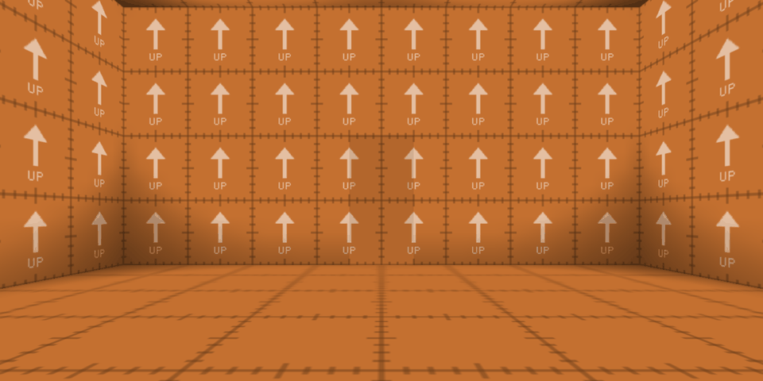
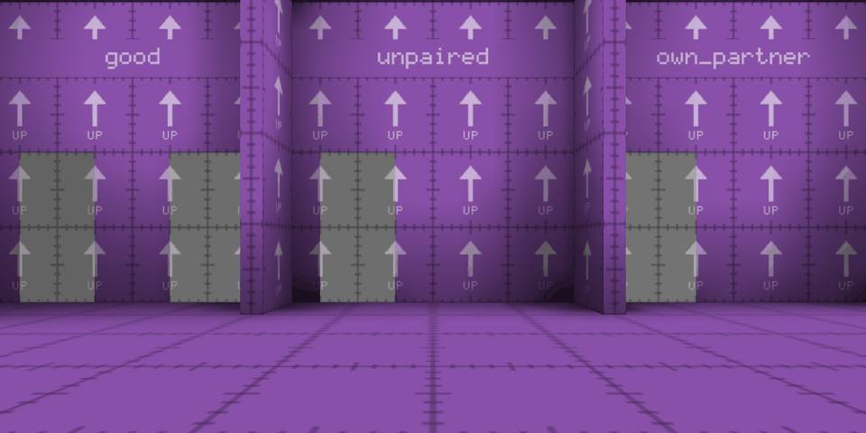
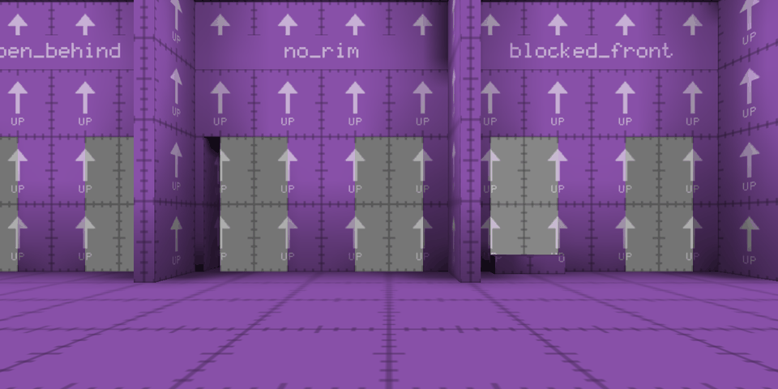

# Chapter 2: Portal ends in a map





This step puts portals into maps. A map's author places a portal's two [ends](glossary.md#portal-end), each an entity with a brush, the [plug](glossary.md#plug), filling its opening. As the map loads, the server and the client each read the ends from the map, pair them, and check that the map has built them right. Nothing is seen through an end yet, and nothing passes through one: each shows as a painted wall, and stops you as the wall around it does.

The first of its [stations](glossary.md#station) is `test_first`, whose thick walls chapter 1 left plain. Each now holds a portal end, a doorway 64 units wide and 128 high, and the two are joined. Above, from chapter 1's spot in the orange room, the end in the north wall shows only as a faintly darker rectangle in the middle of the wall: it's painted with the wall's own texture, lined up with it, and only its light differs a little.

The others are in a new test map, `test_sealed`, whose stations are a row of booths. Each is labelled with a rule that a portal's ends must keep, and holds a portal that breaks it, but for the first, `good`, whose portal keeps them all. A portal that breaks a rule is [sealed](glossary.md#sealed-portal): its ends stay painted walls, and the server warns, naming the end, where it is, and the rule. Here the ends are painted grey, so that you can see them in the purple walls. `good`'s two ends, on the left, look just like the sealed ends beside them, since until chapter 4 draws a view through an end, every end is a painted wall. What tells them apart is what the game prints as the map loads, and that's where this step's checks look.

## What you need to know of ioquake3

**Entities, and the entity string.** A map's brushes are its world, and everything else in it is an [entity](glossary.md#entity): the player's start, a light, an item, a door. An entity is a list of keys and values, among them a `classname`, which says what it is, and an `origin`, which places it. A point entity is only that. A brush entity, such as a door, owns brushes too, which q3map2 compiles into a model of their own, an inline model. q3map2 keeps the entities' keys in the compiled map, as text, the entity string, leaving out only those it uses up itself, such as most lights. As a map starts, qagame reads the string a token at a time, with [`trap_GetEntityToken`](../code/game/g_syscalls.c), and [`G_SpawnEntitiesFromString`](../code/game/g_spawn.c) spawns each entity whose classname is in its [`spawns`](../code/game/g_spawn.c) table. cgame can read the same string, from the renderer, which loads the same map.

**Contents and traces.** Each face of a brush has a shader, and the shader's `surfaceparm`s set the brush's [contents](glossary.md#contents): bits that say what the brush is, such as [`CONTENTS_SOLID`](../code/qcommon/surfaceflags.h) for a wall, or [`CONTENTS_WATER`](../code/qcommon/surfaceflags.h). A brush whose shader says nothing is solid. The collision model, in the `cm_` files of [code/qcommon](../code/qcommon), answers questions about the compiled world: what's at a point, with [`CM_PointContents`](../code/qcommon/cm_test.c), and how far a box moves along a line before it hits something, with [`CM_BoxTrace`](../code/qcommon/cm_trace.c). A trace is given a mask of contents bits, and stops only at brushes whose contents share a bit with it: the player moves with [`MASK_PLAYERSOLID`](../code/game/bg_public.h), and shots fly with [`MASK_SHOT`](../code/game/bg_public.h). The games add their entities, such as doors and bodies, to the world's traces. Collision is with whole brushes, each a convex solid, and nothing cuts a hole in one as the game runs.

**Shaders.** A [shader](glossary.md#shader) is a surface's script, in a `.shader` file in a game folder's `scripts` folder: the images it draws and how, and the `surfaceparm`s that q3map2 reads as it compiles. A texture with no script of its own is drawn as a plain image. Keys starting `qer_` are only for the editors. q3map2 knows a fixed list of surfaceparms, and learns more from a `custinfoparms.txt`, each with the bit it sets, but only when it's given `-custinfoparms`, which chapter 1's build already passes.

**The scene.** cgame decides what's drawn. Each frame, [`CG_DrawActiveFrame`](../code/cgame/cg_view.c) adds what's to be drawn besides the world, each thing as a [`refEntity_t`](../code/renderercommon/tr_types.h), whose [`reType`](../code/renderercommon/tr_types.h) says what it is, such as a model, a sprite or a lightning bolt. The renderer draws the world and them. A model has no lightmap: [`R_SetupEntityLighting`](../code/renderergl1/tr_light.c) lights it from the light grid, the light that q3map2 samples on a grid through the map's open space. The renderer is a library of its own, which shares structures such as `refEntity_t` with the client, so it refuses to start for a client built with another [`REF_API_VERSION`](../code/renderercommon/tr_public.h).

## What stands in the way

- **Quake III Arena has no portal ends.** Nothing in a map can say where an opening is, how big, which way it faces, or what it's joined to. ioquake3's [portal surface](glossary.md#portal-surface) shows a camera's picture on a surface of the map, but has no frame of its own: the renderer takes each surface with a portal shader, wherever q3map2 happened to cut the wall into surfaces, and looks for a `misc_portal_surface` within 64 units of its plane.
- **The opening has to be a hole in the map.** From chapter 7, you step into an end's opening, so the wall must have a hole in it. The hole has to stop everything else, as the wall does, and nothing cuts holes in brushes as the game runs.
- **Both games need the same ends, exactly.** The server moves the player, cgame predicts the same moves, and from chapter 7 both carry the player through ends. If cgame's ends differed from the server's by the smallest fraction, its prediction would stray from the server's moves, and the view would jump. From chapter 4, cgame's ends are what the views are drawn through, too.
- **A map can get an end wrong in many ways, and few of them show.** An end whose partner's name is misspelt, a plug that stops short of the opening's edge, a hole in the world behind it, a step built across its front: most would show only once you'd walked into it, as a hole in the world, a view from inside a wall, or a body stuck in solid.
- **The editors know nothing of portal ends.** An editor learns a game's entities, and their keys, from the game's entity definitions, and has none for quortal's.

## The choices

### A point entity, with its frame in its keys

An end needs an exact frame: its centre, which way it faces, which way its height runs, and its size. A map's author places each end as an `info_portal_end`, a point entity. Its `origin` is the opening's centre, on the surface. Its `angles` turn it as they turn a `misc_model`, so editors already know how to show it and turn it: the end faces forward, and its height runs up. `angle` alone is read as its yaw, since NetRadiant-custom writes only `angle` for an upright end. An end may not have both, or one would silently win over the other. Its `width` and `height` give its size.

An end is a rectangle lying flat on a face of solid world, seen and entered from its front only. One flat, solid face behind each end is what will let the player step into its opening, and a single front halves the cases for drawing views and for crossing. A rectangle is easy to build in an editor, and gives an exact opening to keep a view to and to fit the player through: ovals belong with a portal gun.

A brush would lose the frame. A brush entity whose brush is the plug would be compiled into an inline model, and colliding with one is colliding with an entity, which, as below, the plug mustn't be. A brush entity marking the end beside a plug in the world does no better: the game modules see only an inline model's bounds, a box along the world's axes, which gives no frame for an end turned off the axes or on a slope. Working the rectangle out by tracing the plug as the map loads would be fragile, and a plug can't say which end it pairs with. Nor can a brush in the world keep keys of its own: q3map2 merges only a `func_group`'s brushes into the world, and drops the group's keys.

Portal 2 marks its placed portals the same way. Its `linked_portal_door` is a point entity, turned by its angles, with a width and a height. Portal's own portals are `prop_portal` entities, which a map can place too, but in Portal they have no size: every portal is the size the gun makes.

### Paired by name, and sized at both ends

A portal's two ends pair by naming each other: each has a `targetname`, and `target`s the other's. Editors draw a line from an entity to what it targets, so the author sees the pair, and Quake III Arena already pairs this way: a portal surface targets its camera, and a teleporter its destination. Portal 2's `linked_portal_door` names its partner too, in a key of its own, `partnername`, and Hammer, Source's editor, draws the line. Portal's `prop_portal` pairs as the gun's shots do instead: by a group number, and which of the group's two it is, blue or orange. A name shared by both ends, in a key of quortal's own, would have paired them as well, but no editor would draw it.

Both ends give their size, and give it alike. One end could carry the size for both, but then the other would mean nothing on its own, and an end copied without its partner, or resized without it, would go unnoticed. The two have to be the same size, since nothing that passes through a portal changes size, as chapter 3 says, and checking both catches the slip.

What an end shows when its portal is sealed, or past chapter 6's limit of views inside views, is its `shader`, or black without one. A thin brush in front of the end could have carried the shader instead, but it would fight the portal view for the same depth.

### A plug with a contents bit of its own

From chapter 7, the player steps into an end's opening, so the opening must be a hole in the wall. Nothing cuts one as the game runs, so the map's author builds the hole in. The wall around the opening stays solid, and a brush fills the opening, flush with the surface, 64 units deep: the plug. Portal can't build its holes into its maps, since the player makes its portals in play, wherever the gun puts them, and its developer commentary tells how Source's physics was made to build simpler collision in a bubble around each portal as it's placed. quortal's ends are placed by the author, so the hole can be in the map before the game starts.

The plug has a contents bit of its own, `plug`, which every mask that stops at walls includes, so in this step it stops everything, just as the wall around it does. Chapter 7 takes the bit out of the player's mask alone. Shots and dropped items then still stop at the opening, as at any wall, while the player is held only by the rim around it and the solid world 64 units behind it, deeper than the 50 units a standing body hangs through a floor end before its eye crosses. The plug could have been an entity that the player's traces skip. But a trace skips only the entity that's moving, and what it owns, so both games' traces would have needed a second rule, and the plug would have to be sent to the client in every snapshot. A contents bit needs neither, since the collision model already filters by contents, on both sides.

The bit is `0x400`, which ioquake3 doesn't use. q3map2 learns of it from `custinfoparms.txt`, and only with `-custinfoparms`, so a build that left the flag out would leave the plug without it. The plug's shader also makes it `nonsolid`, since a surface parameter of quortal's own only adds its bit, and a solid plug would stop the player for good; `detail`, so that it neither cuts the map's tree nor blocks what can be seen from where; and `nodraw`, so that nothing of it is drawn. Editors show it see-through, so that the author sees the opening it fills.

### One parser, run by both games

Both games read the ends straight from the map's entity string, with the same code, in a shared `bg_` file that both are built from. Reading the same text with the same code, they hold the same numbers and reach the same verdicts, so nothing about portals need be sent. Configstrings, which the server sends its clients as text, would lose the numbers' precision, and an entity's state reaches the client only while the entity is in the snapshot, while prediction needs every end all the time. Portal has to send its portals, since the player makes them as the game runs, and a `prop_portal` reaches the client as any of Source's entities does. quortal's placed ends are in the map, which the client already has.

To check the ends, cgame needs the world too, and has it: the client loads the same compiled map as the server, collision and all, so cgame runs the same checks against its own copy of the world. So the checks look at the world alone, never at entities, which only the server has whole.

### Checked as the map loads, and sealed when wrong

quortal checks every end as the map loads. The rules:

- A portal's ends pair: each targets the other, by a name no other end has, and no end targets itself.
- Both ends of a portal are the same size.
- The plug fills the opening, 64 units deep, flush with the surface.
- Solid world lies behind the plug, and a solid rim surrounds the opening.
- The space just in front of the end is clear of solid, and so is its partner's visibility point.
- No two plugs overlap.

An end's [visibility point](glossary.md#visibility-point) is where what's seen through it will be worked out from, as chapter 5 explains: a point 8 units in front of its partner's centre. It's computed, never placed by the author.

A portal that breaks a rule is sealed, not refused: its ends keep their rectangles and show their shaders, and they'll never show a view, nor let anything through, since the steps that add those leave sealed ends out. A sealed portal looks like a painted wall, and from chapter 7 it stops you like one, plug or no plug, while the server's warning says why. An end that can't even be placed, since it has no `width` or `height`, or `angles` that aren't three numbers, or both `angle` and `angles`, is skipped: it isn't drawn at all, and its partner is sealed. Refusing the whole map instead would let one mistake stop the rest of it from being played. Quake III Arena is as forgiving: a portal surface whose camera isn't there is dropped, with a line in the console, and the map plays on.

The checks run in the game, on the compiled map, rather than in a tool of their own or a changed q3map2, so that authors keep their stock compilers, and so that what's checked is the collision the player will meet. That's how a build without `-custinfoparms` is caught: its plugs fill nothing, and every portal in it is sealed, so no view ever opens in it, and once crossings come, its ends stop you at their surfaces rather than letting you into the holes behind them. Portal checks each portal as the gun places it, and doesn't place one that fails. quortal's ends are made by the map's author, so they're checked once, as the map loads.

### The renderer draws each end

An end's opening has nothing of the map's to show: the plug is never drawn, and the hole it fills is lined, in quortal's maps, with caulk, which draws nothing either. So cgame passes each end to the renderer as a refEntity of a new type, `RT_PORTAL`, carrying the end's exact rectangle and its partner's exact frame, and the renderer draws the rectangle itself. In this step it draws the end's shader, or black. Chapter 4 draws the portal view inside the same rectangle, which it needs exactly, and not as q3map2 happened to cut the wall into surfaces. ioquake3's portal surfaces have a refEntity type of their own, [`RT_PORTALSURFACE`](../code/renderercommon/tr_types.h), but it draws nothing: it marks where the portal surface is, and where its camera is, and the renderer pairs it with a surface of the map with a portal shader, within 64 units of it. Doom 3 draws its mirrors and remote cameras on surfaces of the map too, whose material says what they show.

### Two editors, one set of definitions

quortal's test maps are made in NetRadiant-custom, whose q3map2 quortal already fetches, and whose releases are for Linux and Windows. TrenchBroom is supported too, but not tested: its Quake III Arena support is experimental, and can't write brush primitives, but it's the one editor with current builds for macOS. Both read one file of entity definitions, which declares `info_portal_end`. NetRadiant-custom has no browser of ready-made pieces, so a sample map holds one finished end, to copy into a map. [Placing portals in a map](how-to/placing-portals-in-a-map.md) sets both editors up, and says where to place an end so that its portal will work and look right.

### A booth for each rule

`test_sealed` has a booth for each rule, with the end that breaks the rule named after it. A check reads the server's warnings as the map loads: exactly one for each booth, naming its end and its rule, and none for `good`. Like chapter 1's checks, it compares quortal with itself: what it expects are rules, never a number recorded from an earlier run.

## The code

### The plug

[`CONTENTS_PLUG`](../code/qcommon/surfaceflags.h) is the plug's bit, the next after `CONTENTS_NOBOTCLIP`, and unused by ioquake3, in [surfaceflags.h](../code/qcommon/surfaceflags.h):

```c
#define CONTENTS_NOBOTCLIP		0x0200
#define	CONTENTS_PLUG			0x0400	// fills a portal end's opening, from custinfoparms.txt
```

[custinfoparms.txt](../data/scripts/custinfoparms.txt) gives q3map2 the same bit, as the surface parameter `plug`, in [custinfoparms.txt](../data/scripts/custinfoparms.txt):

```
// Contents flags
{
	plug		0x400	// CONTENTS_PLUG: fills a portal end's opening
}
```

and the plug's shader sets it, in [quortal.shader](../data/scripts/quortal.shader):

```
textures/quortal/plug
{
	qer_editorimage textures/quortal/plug.png
	qer_trans 0.5
	surfaceparm nonsolid
	surfaceparm nodraw
	surfaceparm detail
	surfaceparm plug
}
```

`qer_editorimage` and `qer_trans` are for the editors, which draw the plug half see-through, with [plug.png](../data/textures/quortal/plug.png). q3map2 and the editors read only the shader files that [shaderlist.txt](../data/scripts/shaderlist.txt) lists, and OpenArena's own, so it lists `quortal`.

Every mask that stops at walls includes the bit too, in [bg_public.h](../code/game/bg_public.h):

```c
// content masks
// every mask stops at a portal end's plug, as at the wall around it
#define	MASK_ALL				(-1)
#define	MASK_SOLID				(CONTENTS_SOLID|CONTENTS_PLUG)
#define	MASK_PLAYERSOLID		(CONTENTS_SOLID|CONTENTS_PLAYERCLIP|CONTENTS_BODY|CONTENTS_PLUG)
#define	MASK_DEADSOLID			(CONTENTS_SOLID|CONTENTS_PLAYERCLIP|CONTENTS_PLUG)
#define	MASK_WATER				(CONTENTS_WATER|CONTENTS_LAVA|CONTENTS_SLIME)
#define	MASK_OPAQUE				(CONTENTS_SOLID|CONTENTS_SLIME|CONTENTS_LAVA|CONTENTS_PLUG)
#define	MASK_SHOT				(CONTENTS_SOLID|CONTENTS_BODY|CONTENTS_CORPSE|CONTENTS_PLUG)
```

A few of ioquake3's traces spell their masks out, such as [`target_laser_think`](../code/game/g_target.c)'s, and would pass through plugs, so in quortal they use these masks. The bots' own are left as they are, since the test maps have no bots.

A change to a mask is a change to a header, and q3lcc can't say which headers a source file includes, so ioquake3's build compiles a QVM's objects again only when their own source file changes, and can leave a QVM with the old mask. In quortal every QVM object depends on [`QVM_HEADERS`](../cmake/utils/qvm_tools.cmake), every header a game module can include.

### Reading the ends

The comment above the code that reads them says what an end's keys are, in [bg_portal.c](../code/game/bg_portal.c):

```c
/*QUAKED info_portal_end (0 .5 1) (-8 -8 -8) (8 8 8)
One end of a portal: a rectangle lying flat on a surface of solid world, seen
and entered from its front. Its opening is filled by a plug, a brush with the
textures/quortal/plug shader on every face, flush with the surface.

"origin"		the centre of the opening, on the surface
"angles"		pitch yaw roll, as misc_model reads them: the end faces forward, and its height runs up
"angle"			yaw alone, in place of "angles"
"width"			the opening's width
"height"		the opening's height
"targetname"	the end's name
"target"		the name of the end it pairs with, which must target this one
"shader"		what the end shows past the nesting limit, black without one
*/
```

The game spawns nothing for an end. [`spawns`](../code/game/g_spawn.c) gives `info_portal_end` the spawn function of `info_null`, which frees the entity at once, so that the game doesn't complain that the classname has no spawn function, in [g_spawn.c](../code/game/g_spawn.c):

```c
	{"info_portal_end", SP_info_null},		// read by G_ReadPortalEnds
```

The ends are read just before the entities are spawned, in [`G_InitGame`](../code/game/g_main.c), in [g_main.c](../code/game/g_main.c):

```c
	G_ReadPortalEnds();

	// parse the key/value pairs and spawn gentities
	G_SpawnEntitiesFromString();
```

So nothing has been spawned yet as they're checked, and the contents at any point are the world's alone. That reads the entity string twice, and ioquake3's server gives it out only once: after its last token, every later read finds nothing. quortal's starts again, as the renderer does for cgame, in [`SV_GameSystemCalls`](../code/server/sv_game.c), in [sv_game.c](../code/server/sv_game.c):

```c
			s = COM_Parse( &sv.entityParsePoint );
			Q_strncpyz( VMA(1), s, args[2] );
			if ( !sv.entityParsePoint && !s[0] ) {
				// start again, as the renderer does for cgame, so that
				// the game can read the entity string more than once
				sv.entityParsePoint = CM_EntityString();
				return qfalse;
			} else {
				return qtrue;
			}
```

[`BG_LoadPortalEnds`](../code/game/bg_portal.c) reads the ends, checks them and warns, with three functions from the game that calls it: one gives it the entity string's tokens, one the world's contents at a point, and one prints a warning. [`G_ReadPortalEnds`](../code/game/g_portal.c) gives it qagame's, in [g_portal.c](../code/game/g_portal.c):

```c
void G_ReadPortalEnds( void ) {
	level.numPortalEnds = BG_LoadPortalEnds( trap_GetEntityToken, G_PortalEndContents, G_PortalEndWarning,
		level.portalEnds, MAX_PORTAL_ENDS );
}
```

and [`CG_ReadPortalEnds`](../code/cgame/cg_portal.c) gives it cgame's, once cgame has loaded the map, in [cg_portal.c](../code/cgame/cg_portal.c):

```c
	trap_Cvar_VariableStringBuffer( "developer", var, sizeof( var ) );

	cgs.numPortalEnds = BG_LoadPortalEnds( trap_GetEntityToken, CG_PortalEndContents,
		atoi( var ) ? CG_PortalEndWarning : NULL, cgs.portalEnds, MAX_PORTAL_ENDS );
```

[`G_PortalEndContents`](../code/game/g_portal.c) asks for the contents at a point with [`trap_PointContents`](../code/game/g_syscalls.c), and [`CG_PortalEndContents`](../code/cgame/cg_portal.c) asks the collision model for the world's, with [`trap_CM_PointContents`](../code/cgame/cg_syscalls.c). cgame warns only under [`developer`](../code/qcommon/common.c), since the server has warned already.

[`BG_ReadPortalEnds`](../code/game/bg_portal.c) walks the tokens, gathering each entity's keys, and reads an end from each `info_portal_end`, in [bg_portal.c](../code/game/bg_portal.c):

```c
	while ( getToken( key, sizeof( key ) ) ) {
		if ( !strcmp( key, "{" ) ) {
			memset( &keys, 0, sizeof( keys ) );
			continue;
		}

		if ( !strcmp( key, "}" ) ) {
			if ( !Q_stricmp( keys.classname, "info_portal_end" ) ) {
				if ( numFound < maxEnds ) {
					BG_ReadPortalEnd( &keys, &ends[numFound] );
				}
				numFound++;
			}
			continue;
		}
```

It counts every end, even past `maxEnds`, so that `BG_LoadPortalEnds` can warn that some weren't read, and it reads to the end of the string, whatever comes, so that the next reader starts at the beginning again. [`BG_ReadPortalEnd`](../code/game/bg_portal.c) reads the frame's keys in turn, until one can't be read, in [bg_portal.c](../code/game/bg_portal.c):

```c
	// the frame's keys are read in turn, until one can't be
	VectorClear( angles );
	if ( !BG_ParseNumbers( keys->width, &end->width, 1 ) || end->width <= 0 ) {
		end->rule = PR_NO_WIDTH;
	} else if ( !BG_ParseNumbers( keys->height, &end->height, 1 ) || end->height <= 0 ) {
		end->rule = PR_NO_HEIGHT;
	} else if ( keys->angles[0] && keys->angle[0] ) {
		end->rule = PR_ANGLE_AND_ANGLES;
	} else if ( keys->angles[0] && !BG_ParseNumbers( keys->angles, angles, 3 ) ) {
		end->rule = PR_BAD_ANGLES;
	} else if ( keys->angle[0] && !BG_ParseNumbers( keys->angle, &angles[YAW], 1 ) ) {
		end->rule = PR_BAD_ANGLES;
	}
	AnglesToAxis( angles, end->axis );
```

[`BG_ParseNumbers`](../code/game/bg_portal.c) reads a key only if it's that many numbers and nothing else, so `angles` of `270`, which `test_sealed`'s `bad_angles` has, are unreadable, and not a pitch. A width or height that isn't more than 0 counts as none. [`AnglesToAxis`](../code/qcommon/q_math.c) turns the angles into the end's axes, as it does a model's: forward, out of the surface, then left, along the width, then up. Each end comes out as a [`portalEnd_t`](../code/game/bg_public.h), in [bg_public.h](../code/game/bg_public.h):

```c
typedef struct {
	char				targetname[MAX_QPATH];
	char				target[MAX_QPATH];
	char				shader[MAX_QPATH];		// shown past the nesting limit, black if empty

	vec3_t				origin;					// the opening's centre, on the surface
	vec3_t				axis[3];				// facing out of the surface, then along its width, then up its height
	float				width;
	float				height;

	int					partner;				// the end it pairs with, or -1
	int					overlap;				// an end whose plug its own overlaps, or -1
	portalEndState_t	state;
	portalRule_t		rule;					// the rule it broke itself, if any
	vec3_t				visOrigin;				// where its view is seen from, if it's open
} portalEnd_t;
```

`partner` and `overlap` are the numbers of other ends in the same array, `rule` is the first rule the end broke itself, and `state` is its verdict. `visOrigin` is its visibility point.

### Pairing

[`BG_PairPortalEnd`](../code/game/bg_portal.c) finds an end's partner, or the rule it breaks. The last of its tests, in [bg_portal.c](../code/game/bg_portal.c):

```c
	if ( !Q_stricmp( end->target, end->targetname ) ) {
		*rule = PR_OWN_PARTNER;
		return -1;
	}

	partner = BG_FindPortalEnd( ends, numEnds, end->target );
	if ( partner == -1 ) {
		*rule = PR_NO_SUCH_TARGET;
		return -1;
	}
	if ( partner == -2 ) {
		*rule = PR_SHARED_TARGET;
		return -1;
	}
	if ( Q_stricmp( ends[partner].target, end->targetname ) ) {
		*rule = PR_NOT_MUTUAL;
		return -1;
	}

	return partner;
```

[`BG_FindPortalEnd`](../code/game/bg_portal.c) returns -2 when more than one end has the name, so names have to be unique for ends to pair. Names are compared as Quake III Arena compares targets, without regard to case. A portal whose two ends differ in size breaks that rule once, at the end whose name sorts first, so that the warning doesn't change when the map's entities are put in another order.

### The world around an end

[`BG_CheckPortalEndWorld`](../code/game/bg_portal.c) checks the world around an end by sampling it. [`BG_PortalEndLayerHolds`](../code/game/bg_portal.c) samples one layer, a rectangle parallel to the opening at some depth behind its surface, at its corners, along its edges, and across it every 16 units out from its centre, and asks whether every sample's contents hold some bits and none of some others. For an end 64 by 128, that's 45 points a layer. The plug comes first, in [bg_portal.c](../code/game/bg_portal.c):

```c
	// the samples in the opening fall short of its edges by the tolerance
	halfWidth = end->width / 2 - PORTAL_TOLERANCE;
	halfHeight = end->height / 2 - PORTAL_TOLERANCE;

	// the plug fills the opening, PORTAL_PLUG_DEPTH units deep, sampled at
	// its front and back as well as between. It isn't solid, and nothing
	// solid fills the opening with it. It's flush with the surface, so none
	// of it stands in front
	if ( !BG_PortalEndLayerHolds( end, pointContents, halfWidth, halfHeight,
			-PORTAL_TOLERANCE, qfalse, 0, CONTENTS_PLUG ) ) {
		return PR_UNFILLED;
	}

	halfDepth = PORTAL_PLUG_DEPTH / 2 - PORTAL_TOLERANCE;
	numDeep = BG_PortalSampleCount( halfDepth );
	for ( i = 0 ; i < numDeep ; i++ ) {
		if ( !BG_PortalEndLayerHolds( end, pointContents, halfWidth, halfHeight,
				PORTAL_PLUG_DEPTH / 2 + BG_PortalSample( halfDepth, i, numDeep ), qfalse,
				CONTENTS_PLUG, CONTENTS_SOLID ) ) {
			return PR_UNFILLED;
		}
	}
```

So the plug is sampled at depths of 1, 16, 32, 48 and 63 units, where every sample must be plug and nothing solid, and 1 unit in front of the surface, where no sample may be plug, so that a plug that stands proud of the wall doesn't fill the opening either. The world behind and around the plug comes next, in [bg_portal.c](../code/game/bg_portal.c):

```c
	// solid world lies behind the plug
	if ( !BG_PortalEndLayerHolds( end, pointContents, halfWidth, halfHeight,
			PORTAL_PLUG_DEPTH + PORTAL_TOLERANCE, qfalse, CONTENTS_SOLID, 0 ) ) {
		return PR_OPEN_BEHIND;
	}

	// and a solid rim surrounds the opening, just beyond its edges and just
	// behind its surface
	if ( !BG_PortalEndLayerHolds( end, pointContents, end->width / 2 + PORTAL_TOLERANCE,
			end->height / 2 + PORTAL_TOLERANCE, PORTAL_TOLERANCE, qtrue, CONTENTS_SOLID, 0 ) ) {
		return PR_NO_RIM;
	}

	// the space just in front of the end is clear of solid
	if ( !BG_PortalEndLayerHolds( end, pointContents, halfWidth, halfHeight,
			-PORTAL_TOLERANCE, qfalse, 0, CONTENTS_SOLID ) ) {
		return PR_BLOCKED_FRONT;
	}

	// and so is its partner's visibility point, in front of it
	VectorMA( end->origin, PORTAL_VIS_DISTANCE, end->axis[0], point );
	if ( pointContents( point ) & CONTENTS_SOLID ) {
		return PR_BLOCKED_VIS_POINT;
	}
```

The rim is sampled along the edges alone, a unit outside the opening and a unit behind its surface. So between two ends side by side there has to be solid wall.

Every sample is within [`PORTAL_TOLERANCE`](../code/game/bg_portal.c), a unit, of where the end's keys place it. So the plug has to match the keys to within a unit all the way back: an end turned 1° from its plug is 63 × sin 1°, about 1.1 units, out at the plug's back, and is sealed as unfilled.

[`BG_PortalPlugsOverlap`](../code/game/bg_portal.c) looks for plugs that overlap where their ends' keys place them, rather than where the brushes are. Each plug is a box, and two boxes are apart when some direction separates them: their shadows on a line along it don't overlap. Only the boxes' own axes, and the cross products of an axis of one with an axis of the other, need trying, in [bg_portal.c](../code/game/bg_portal.c):

```c
	// along each axis, the shadows overlap by how far the boxes reach
	// together, less how far apart their centres are
	for ( i = 0 ; i < numAxes ; i++ ) {
		reach = 0;
		for ( j = 0 ; j < 3 ; j++ ) {
			reach += extentsA[j] * fabs( DotProduct( a->axis[j], axes[i] ) );
			reach += extentsB[j] * fabs( DotProduct( b->axis[j], axes[i] ) );
		}

		if ( reach - fabs( DotProduct( delta, axes[i] ) ) <= PORTAL_TOLERANCE ) {
			return qfalse;
		}
	}
```

Boxes that overlap by a unit or less only touch, and pass. Both ends of an overlapping pair break the rule, so both portals are sealed, but the pair is warned about once.

### The verdicts

[`BG_CheckPortalEnds`](../code/game/bg_portal.c) gives each end the first rule it breaks, trying them in this order: its frame, as it's read, then pairing, size, overlapping plugs, and last the world, which an end is checked against only once it has broken nothing else. Then each end gets its state, in [bg_portal.c](../code/game/bg_portal.c):

```c
	for ( i = 0 ; i < numEnds ; i++ ) {
		end = &ends[i];
		if ( end->state == PE_SKIPPED ) {
			continue;
		}
		if ( end->rule != PR_NONE ) {
			end->state = PE_SEALED;
			continue;
		}

		partner = &ends[end->partner];
		if ( partner->rule != PR_NONE ) {
			end->state = PE_SEALED;
			continue;
		}

		end->state = PE_OPEN;
		VectorMA( partner->origin, PORTAL_VIS_DISTANCE, partner->axis[0], end->visOrigin );
	}
```

An end that breaks no rule itself is still sealed when its partner breaks one, or was skipped, since a skipped end pairs all the same. Only an open end has a visibility point. The states, in [bg_public.h](../code/game/bg_public.h):

```c
typedef enum {
	PE_OPEN,				// seen and passed through
	PE_SEALED,				// a painted wall: no view, no visibility point and no crossing
	PE_SKIPPED				// no usable frame, so not an end at all, and its partner is sealed
} portalEndState_t;
```

A sealed end is still drawn, while a skipped one, with no frame, isn't.

[`BG_PortalEndWarning`](../code/game/bg_portal.c) words the warning for an end that broke a rule itself, in [bg_portal.c](../code/game/bg_portal.c):

```c
	Com_sprintf( warning, sizeof( warning ), S_COLOR_YELLOW "WARNING: portal end \"%s\" at (%i %i %i) %s\n",
		end->targetname, (int)end->origin[0], (int)end->origin[1], (int)end->origin[2], rule );
```

[`BG_PortalEndRule`](../code/game/bg_portal.c) words the rule, so that `test_sealed`'s server prints, for instance:

```
WARNING: portal end "no_rim" at (2624 384 64) has no solid rim around it
```

[`g_listPortalEnds`](../code/game/g_main.c), the step's debug cvar, is cheat-protected. Set to 1, it lists every end once, with its verdict, and [`G_RunFrame`](../code/game/g_main.c) sets it back to 0, as ioquake3's [`g_listEntity`](../code/game/g_main.c) does. [`G_ListPortalEnds`](../code/game/g_portal.c) prints the list, in [g_portal.c](../code/game/g_portal.c):

```c
	for ( i = 0 ; i < level.numPortalEnds ; i++ ) {
		end = &level.portalEnds[i];

		if ( end->state == PE_OPEN ) {
			verdict = va( "open, paired with \"%s\"", end->target );
		} else if ( end->state == PE_SKIPPED ) {
			verdict = va( "skipped: it %s", BG_PortalEndRule( level.portalEnds, i ) );
		} else if ( end->rule != PR_NONE ) {
			verdict = va( "sealed: it %s", BG_PortalEndRule( level.portalEnds, i ) );
		} else {
			verdict = va( "sealed by its partner \"%s\"", end->target );
		}

		G_Printf( "%3i: \"%s\" at %s: %s\n", i, end->targetname, vtos( end->origin ), verdict );
	}
```

So a sealed end says whether it broke a rule itself, or was sealed by its partner, as [Try it](#try-it) shows.

### Drawing an end

[`RT_PORTAL`](../code/renderercommon/tr_types.h) is the new type of refEntity, in [tr_types.h](../code/renderercommon/tr_types.h):

```c
	RT_PORTAL,				// a portal end's rectangle, at origin along axis, and its partner's frame
```

and three fields carry what it needs besides the refEntity's own `origin` and `axis`, in [tr_types.h](../code/renderercommon/tr_types.h):

```c
	// extra portal information
	float		halfWidth;			// how far the end reaches along axis[1] either side of origin
	float		halfHeight;			// and along axis[2]
	orientation_t	partner;		// the frame of the end it pairs with, if it pairs
```

`refEntity_t` has grown, so `REF_API_VERSION` is now 9. Each frame, [`CG_AddPortalEnds`](../code/cgame/cg_portal.c) passes every end that wasn't skipped, in [cg_portal.c](../code/cgame/cg_portal.c):

```c
		memset( &ent, 0, sizeof( ent ) );
		ent.reType = RT_PORTAL;

		VectorCopy( end->origin, ent.origin );
		AxisCopy( end->axis, ent.axis );
		ent.halfWidth = end->width / 2;
		ent.halfHeight = end->height / 2;

		ent.renderfx = RF_LIGHTING_ORIGIN;
		VectorMA( end->origin, PORTAL_LIGHT_DISTANCE, end->axis[0], ent.lightingOrigin );

		if ( end->partner != -1 && cgs.portalEnds[end->partner].state != PE_SKIPPED ) {
			partner = &cgs.portalEnds[end->partner];
			VectorCopy( partner->origin, ent.partner.origin );
			AxisCopy( partner->axis, ent.partner.axis );
		}
```

The end is lit from the light grid, as a model is, and its centre lies on the surface, where the grid's samples are in the wall. So it's lit from a point [`PORTAL_LIGHT_DISTANCE`](../code/cgame/cg_portal.c), 32 units, in front of it, half the grid's usual spacing. The partner's frame isn't used yet: chapter 4 draws the view from it.

The end's shader goes to the renderer as a skin, in [cg_portal.c](../code/cgame/cg_portal.c):

```c
	// an end's shader is registered as a skin of one shader, as a model's
	// surfaces get theirs, so that a texture with no shader of its own is
	// lit as a model is, rather than drawn as a 2D picture
	for ( i = 0 ; i < cgs.numPortalEnds ; i++ ) {
		if ( cgs.portalEnds[i].shader[0] ) {
			cgs.portalEndSkins[i] = trap_R_RegisterSkin( cgs.portalEnds[i].shader );
		} else {
			cgs.portalEndSkins[i] = 0;
		}
	}
```

A shader registered the usual way, with [`RE_RegisterShader`](../code/renderergl1/tr_shader.c), is for 2D pictures when the texture has no script of its own, as quortal's wall textures haven't, and is drawn with no depth test. A skin of one shader, from [`RE_RegisterSkin`](../code/renderergl1/tr_image.c), is lit as a model's surface is. [`R_AddEntitySurfaces`](../code/renderergl1/tr_main.c) takes the skin's shader, or black, in [tr_main.c](../code/renderergl1/tr_main.c):

```c
		case RT_PORTAL:
			// the end's shader comes as a skin of one shader
			if ( ent->e.customSkin ) {
				shader = R_GetSkinByHandle( ent->e.customSkin )->surfaces[0].shader;
			} else {
				shader = tr.blackShader;
			}
			R_SetupEntityLighting( &tr.refdef, ent );
			R_AddDrawSurf( &entitySurface, shader, R_SpriteFogNum( ent ), 0 );
			break;
```

`tr.blackShader` is new, made as the renderer starts, with ioquake3's other internal shaders, in [`CreateInternalShaders`](../code/renderergl1/tr_shader.c). [`RB_SurfacePortal`](../code/renderergl1/tr_surface.c) draws the rectangle as a quad, flush with the surface, and lays the shader on at the usual scale of 0.5, from the world's origin, the right way round as seen from in front, in [tr_surface.c](../code/renderergl1/tr_surface.c):

```c
	// the end's centre, and how far it reaches either side, in texels
	s = DotProduct( e->origin, e->axis[1] ) * TEXELS_PER_UNIT;
	t = -DotProduct( e->origin, e->axis[2] ) * TEXELS_PER_UNIT;
	halfS = e->halfWidth * TEXELS_PER_UNIT;
	halfT = e->halfHeight * TEXELS_PER_UNIT;

	// seen from in front, the end's width runs to the right
	VectorScale( e->axis[1], -e->halfWidth, left );
	VectorScale( e->axis[2], e->halfHeight, up );

	RB_AddQuadStampExt( e->origin, left, up, e->shaderRGBA,
		( s - halfS ) / image->width, ( t - halfT ) / image->height,
		( s + halfS ) / image->width, ( t + halfT ) / image->height );
```

So the end's texture carries on the wall's, as long as the wall is textured the same way, as quortal's maps are.

### The test maps

[test_first.map](../data/maps/test_first.map) gains its two ends, each in the middle of one of the thick walls, facing into its room, and each targeting the other. The orange room's, in [test_first.map](../data/maps/test_first.map):

```
// entity 10
{
"classname" "info_portal_end"
"origin" "0 256 64"
"angle" "270"
"width" "64"
"height" "128"
"targetname" "orange"
"target" "blue"
"shader" "textures/quortal/wall_orange"
}
```

Its shader is the wall's, so the end looks like the wall. Behind each end, a plug fills a hole in the wall 64 units deep, with solid wall behind it.



[test_sealed.map](../data/maps/test_sealed.map) is one long room, its north wall a row of fourteen booths, each 256 units wide, between walls jutting 64 units out, and labelled at the top. Each booth's ends face south, from the wall at its back. The end that breaks the booth's rule is named after the rule, and its partner after the end, with `_partner` added, such as `no_rim` and `no_rim_partner`. Above are three of the booths whose world is built wrong: `open_behind`, whose fault is out of sight behind its end, `no_rim`, with a slot beside its first end, so that the wall doesn't surround the opening, and `blocked_front`, with a kerb across the foot of its first end. The four booths whose end is skipped, from `no_width` to `angle_and_angles`, have no plug in that end's opening, which is walled up instead, since a skipped end isn't drawn. [dev-textures.py](../misc/dev-textures.py) draws the booths' labels, from its [`LABELS`](../misc/dev-textures.py), and the plug's picture for the editors.

### The editors

[misc/editors](../misc/editors) holds what the editors need. One file of entity definitions, [entities.ent](../misc/editors/netradiant-custom/quortal.game/quortal/entities.ent), is the OpenArena gamepack's, less the entities quortal's game doesn't spawn, with `info_portal_end` added. It declares `angles` as well as `angle`, since TrenchBroom only writes `angles` when the definitions declare it. Beside it are NetRadiant-custom's gamepack, TrenchBroom's game configuration, with a compile profile that passes `-custinfoparms`, and [portal_end.map](../misc/editors/portal_end.map), the sample map with one finished end. The [how-to](how-to/placing-portals-in-a-map.md) puts them to use.

### The checks

[tests.cmake](../cmake/tests.cmake) lists the warnings `test_sealed` must give, each as the end and the start of its rule, in [tests.cmake](../cmake/tests.cmake):

```cmake
# test_sealed has a booth for each rule a portal can break, and one good
# portal. In each booth the end that breaks the rule is named after it, and
# the server warns about that end once, naming the rule. It warns about
# nothing else, and cgame, under developer, warns alike
set(TEST_SEALED_WARNINGS
    "unpaired doesn't pair"
    "own_partner targets itself"
    "size_mismatch isn't the size of its partner"
    "no_width has no width"
    "no_height has no height"
    "bad_angles has unreadable angles"
    "angle_and_angles has both angle and angles"
    "unfilled isn't filled by a plug 64 units deep"
    "open_behind has no solid world behind its plug"
    "no_rim has no solid rim around it"
    "blocked_front has solid just in front of it"
    "blocked_vis_point has solid at its partner's visibility point"
    "overlapping overlaps the plug of")
```

Each becomes a regular expression, in [`TEST_SEALED_WARNING_LINES`](../cmake/tests.cmake): the end's name in quotes, its position, then the start of its rule. The server's check expects exactly those, in [tests.cmake](../cmake/tests.cmake):

```cmake
    add_game_test(server_warns_once_per_test_sealed_booth
        GAME ${SERVER_BINARY}
        LABEL server
        TIMEOUT 60
        ARGS +map test_sealed +quit
        LINES "WARNING: .*portal end"
        EXPECT_LINES ${TEST_SEALED_WARNING_LINES})
    list(APPEND MAP_TESTS server_warns_once_per_test_sealed_booth)
```

[`add_game_test`](../cmake/utils/add_game_test.cmake) has new options. With `LINES`, a regular expression, the lines of the log that match it must be matched one for one by those of `EXPECT_LINES`: a warning too many, or one missing, fails. With `TWICE`, the lines come twice over, the server's and then cgame's, as they do in [`cgame_warns_as_the_server_does`](../cmake/tests.cmake), which starts the client on `test_sealed` under `developer` 1, and the second half must repeat the first. And with `MAP`, the check compiles a map into its own home folder first, where the game finds it before the copy in `quortal.pk3`, and with `NO_CUSTINFOPARMS` as well, compiles it without `-custinfoparms`.

[`server_finds_test_first_portal_open`](../cmake/tests.cmake) lists `test_first`'s ends with `g_listPortalEnds`, and expects both open, each paired with the other, and no warning. [`server_seals_test_first_compiled_without_custinfoparms`](../cmake/tests.cmake) compiles `test_first` with `MAP` and `NO_CUSTINFOPARMS`, and expects both ends to be sealed by the plug rule. [compile_map.cmake](../cmake/utils/compile_map.cmake) leaves the flag out of every stage for it, in [compile_map.cmake](../cmake/utils/compile_map.cmake):

```cmake
function(run_stage STAGE)
    set(OPTIONS ${ARGN})
    if(NOT CUSTINFOPARMS)
        list(REMOVE_ITEM OPTIONS -custinfoparms)
    endif()
```

## Try it

`test_first`'s ends are the first station. Start in the orange room, facing its end:

```sh
build/Release/quortal.x86_64 +devmap test_first
```

Walk into the end: it stops you where the wall would. The blue room's end is in its south wall, where chapter 1's `setviewpos 1024 240 24 -90` faces it. `setviewpos` pushes you forward as it puts you there, and chapter 4 adds `station`, which puts you at a named station at rest.

**The ends and their verdicts.** The step's debug cvar is `g_listPortalEnds`. It's cheat-protected, so it can be set once `devmap` has turned cheats on. In the console:

```
g_listPortalEnds 1
```

and the server lists the ends:

```
2 portal ends:
  0: "orange" at (0 256 64): open, paired with "blue"
  1: "blue" at (1024 -256 64): open, paired with "orange"
```

**The booths.** `test_sealed`'s booths are the other stations:

```sh
build/Release/quortal.x86_64 +devmap test_sealed
```

As it loads, the server warns about thirteen ends, one in each booth but `good`, where you start. The booths are 256 units wide, in the order of the warnings, so the middle of the booth that's *n* along from `good` is at x = 128 + 256 × *n*. `setviewpos 2688 16 24 90` faces `no_rim`, ten along, from across the room. `g_listPortalEnds 1` lists all 26 ends, among them:

```
  0: "good" at (64 384 64): open, paired with "good_partner"
  1: "good_partner" at (192 384 64): open, paired with "good"
  2: "unpaired" at (320 384 64): sealed: it doesn't pair, as no end is named "unpaired_partner"
  3: "own_partner" at (576 384 64): sealed: it targets itself
  4: "size_mismatch" at (832 384 64): sealed: it isn't the size of its partner "size_mismatch_partner"
  5: "size_mismatch_partner" at (960 384 48): sealed by its partner "size_mismatch"
  6: "no_width" at (1088 384 64): skipped: it has no width
  7: "no_width_partner" at (1216 384 64): sealed by its partner "no_width"
```

**cgame's verdicts.** Start with `+set developer 1` as well, and each warning comes twice: the server's, then cgame's, which reached the same verdicts with its own copy of the map.

**A build that forgot `-custinfoparms`.** Compile `test_first` without it into a home folder of its own, and start the dedicated server on it there:

```sh
cmake -DQ3MAP2=$PWD/build/q3map2/bin/q3map2 -DMAP_FILE=$PWD/data/maps/test_first.map \
    -DBSP_FILE=/tmp/plugless/quortal/maps/test_first.bsp -DWORK_DIR=/tmp/plugless/work \
    -DDATA_DIR=$PWD/data -DGAME_DIR=$PWD/build/Release/quortal -DCUSTINFOPARMS=OFF \
    -P cmake/utils/compile_map.cmake
build/Release/quortal-ded.x86_64 +set fs_homepath /tmp/plugless +map test_first
```

q3map2 warns as it compiles, with `Unknown surfaceparm: "plug"`, and the server finds no plug in either opening:

```
WARNING: portal end "orange" at (0 256 64) isn't filled by a plug 64 units deep, flush with its surface
WARNING: portal end "blue" at (1024 -256 64) isn't filled by a plug 64 units deep, flush with its surface
```

**The checks.** `ctest --test-dir build` runs all seven, and `ctest --test-dir build -L server` runs the four that start the dedicated server.

## Limits

- **Nothing is seen through an end yet.** Chapter 4 draws portal views. Until then, an open end looks just like a sealed one.
- **Nothing passes through one.** Every end stops the player as the wall does, since the player's mask still holds the plug's bit, and chapter 7 takes it out. But an end sealed because nothing fills its opening, as in a build without `-custinfoparms`, doesn't stop you yet: you walk through its painted surface into the hole behind it. Chapter 7 makes every sealed end stop you at its surface.
- **The visibility point isn't used yet.** Chapter 5 sends and draws what's seen from it.
- **The checks see only the world.** A door, a platform or anything else that moves into the space in front of an end, or across its plug, isn't caught.
- **Clusters aren't checked.** q3map2 cuts a map's open space into clusters, and an end's opening that spans two of them still gets one visibility point. [Placing portals in a map](how-to/placing-portals-in-a-map.md#keep-each-end-within-one-cluster) says how to keep each end within one.
- **The plug follows its end by hand.** The editors show an end as a small box, so it's the plug that shows the opening, and moving, turning or resizing one means doing the same to the other, to within a unit.
- **An end isn't lit as the wall is.** It's lit from the light grid, one light for the whole end, while the wall around it has a lightmap, so its light differs a little, most near the floor. That's the faint rectangle in the pictures. Its texture carries on the wall's only when the wall is textured as quortal's maps are, at a scale of 0.5 from the world's origin, and a shader that uses the surface's normals, such as an environment map, comes out wrong on it.
- **A map holds 128 ends at most.** Only the first [`MAX_PORTAL_ENDS`](../code/game/bg_public.h) are read, and the server warns that there are more.
- **TrenchBroom isn't tested,** and on macOS there's no q3map2 to fetch for it, so the maps it makes there can't be compiled without building q3map2.

What milestone 1 as a whole leaves out, with what lifting each limit would take, is the subject of its last chapter, chapter 9.

## How it was built

- [`d9e3c5f6`](https://github.com/takumu-dev/quortal/commit/d9e3c5f63174b6ade3c47b9f9b993bbbe06675ff) fix(build): compile a QVM's objects again when a header changes
- [`4f0eb590`](https://github.com/takumu-dev/quortal/commit/4f0eb590fc1c5a87936e72b2559e7afc8d1eb661) feat(game): add the plug, which fills a portal end's opening
- [`2b50beee`](https://github.com/takumu-dev/quortal/commit/2b50beee65f6c7aa68f94ba1dcf3420af7bf7d32) feat(server): let the game read the entity string more than once
- [`9043680a`](https://github.com/takumu-dev/quortal/commit/9043680a4ea7aa1a3681251a00912c30bd7337ad) test: check the lines of a log that match a pattern, one for one
- [`5973d15a`](https://github.com/takumu-dev/quortal/commit/5973d15aa588dbf914a9afcd1927ce0a0f1ea09f) feat(data): paint the labels of test_sealed's booths
- [`97099753`](https://github.com/takumu-dev/quortal/commit/97099753349eb1078963b1f09c6de32481926517) feat(game): read portal ends, and seal those that don't pair
- [`e34caf40`](https://github.com/takumu-dev/quortal/commit/e34caf40eb4d9305ff31fd538abda97ea1c57a36) feat(game): seal a portal end that targets itself
- [`d6bbbdd5`](https://github.com/takumu-dev/quortal/commit/d6bbbdd5d657c02f5873c06229e02ec644a016ad) feat(game): seal a portal whose ends differ in size
- [`f78de646`](https://github.com/takumu-dev/quortal/commit/f78de646a3cd85b3e6c7a25cd9c57edf1a0e1401) feat(game): skip a portal end with no usable frame
- [`a8f8e627`](https://github.com/takumu-dev/quortal/commit/a8f8e627288f5d6f76b469c6c96f79d8fed538e0) feat(cgame): read portal ends with the server's own code
- [`84786575`](https://github.com/takumu-dev/quortal/commit/84786575bb4940d96ca3703f92485a9e20ce72df) feat(game): list portal ends and their verdicts with g_listPortalEnds
- [`8d3d4a5c`](https://github.com/takumu-dev/quortal/commit/8d3d4a5cbc543648a0d3f87fd08456870ec6218a) feat(maps): give test_first its two portal ends
- [`e084098b`](https://github.com/takumu-dev/quortal/commit/e084098b0490ead8c0aa60e1a48a410a77a1dee1) feat(game): seal a portal end whose plug doesn't fill it
- [`4c09b9f6`](https://github.com/takumu-dev/quortal/commit/4c09b9f63a59ff0e0d7ec05915d8a53eb3615bb9) feat(game): seal a portal end with no solid world behind its plug
- [`4077cc6c`](https://github.com/takumu-dev/quortal/commit/4077cc6c440051870e204199ae8f47b2db045b7b) feat(game): seal a portal end with no solid rim around it
- [`ae21672b`](https://github.com/takumu-dev/quortal/commit/ae21672b355460cee11bd37e95f22df5dcb810c9) feat(game): seal a portal end with solid just in front of it
- [`ab84fdda`](https://github.com/takumu-dev/quortal/commit/ab84fdda793d05bb8ce1e44c9e70b2606f8a955c) feat(game): seal a portal end with solid at its partner's visibility point
- [`eb5c8dc7`](https://github.com/takumu-dev/quortal/commit/eb5c8dc796d17edb559145578ea4ce42f488cbd6) feat(game): seal portal ends whose plugs overlap
- [`ab730c77`](https://github.com/takumu-dev/quortal/commit/ab730c776d5d8d8afd19d32361951d9660f94200) test: check that test_first compiled without -custinfoparms is sealed
- [`e73ccba1`](https://github.com/takumu-dev/quortal/commit/e73ccba1239c373be5a135e6f4ac55b33fe91ce6) test: check that cgame warns about test_sealed as the server does
- [`f9aaf4a8`](https://github.com/takumu-dev/quortal/commit/f9aaf4a8402dbb1b56afa0d797d6a00acde9eca3) feat(renderer): draw a portal end's surface, passed as RT_PORTAL
- [`a1e8a031`](https://github.com/takumu-dev/quortal/commit/a1e8a031a9fb4877ca8c10b95df1919e35fc5a2a) feat(cgame): pass every portal end to the renderer
- [`d331911b`](https://github.com/takumu-dev/quortal/commit/d331911bf6cf60f4062dfa19b3c66e970479a406) feat(maps): wall up the openings of test_sealed's skipped ends
- [`01e4f0be`](https://github.com/takumu-dev/quortal/commit/01e4f0be1a543d3842ccba20c0ad690dc5438b1c) feat(editors): take the OpenArena gamepack's entity definitions
- [`090c3507`](https://github.com/takumu-dev/quortal/commit/090c3507fa720eb0a2be3fa6b675d5332441db0c) feat(editors): leave out the entities quortal's game doesn't spawn
- [`f4cdb80a`](https://github.com/takumu-dev/quortal/commit/f4cdb80ad21d8f89418ee05e04820dc42f71732e) feat(editors): declare info_portal_end
- [`05ec8cd7`](https://github.com/takumu-dev/quortal/commit/05ec8cd7b252a3dd63b8686316f74b4c8455b325) feat(editors): add a NetRadiant-custom gamepack for quortal
- [`60b31365`](https://github.com/takumu-dev/quortal/commit/60b313659f5f9f9c7f52001d6c37b58e3543d200) feat(editors): add a TrenchBroom game configuration for quortal
- [`3bbe6da1`](https://github.com/takumu-dev/quortal/commit/3bbe6da1d9d18c71f5491e1cdd63ada221dec4ef) feat(editors): add a sample map with one finished portal end
- [`fec95bba`](https://github.com/takumu-dev/quortal/commit/fec95bbaa71338fa92e7ff3f1a502ef1538971fb) docs: say that the editors' entity definitions keep their own licence
- [`f7b7a73d`](https://github.com/takumu-dev/quortal/commit/f7b7a73dd458fd861fed00b6aea908d3f0fb4ec6) docs: add the how-to on placing portals in a map
